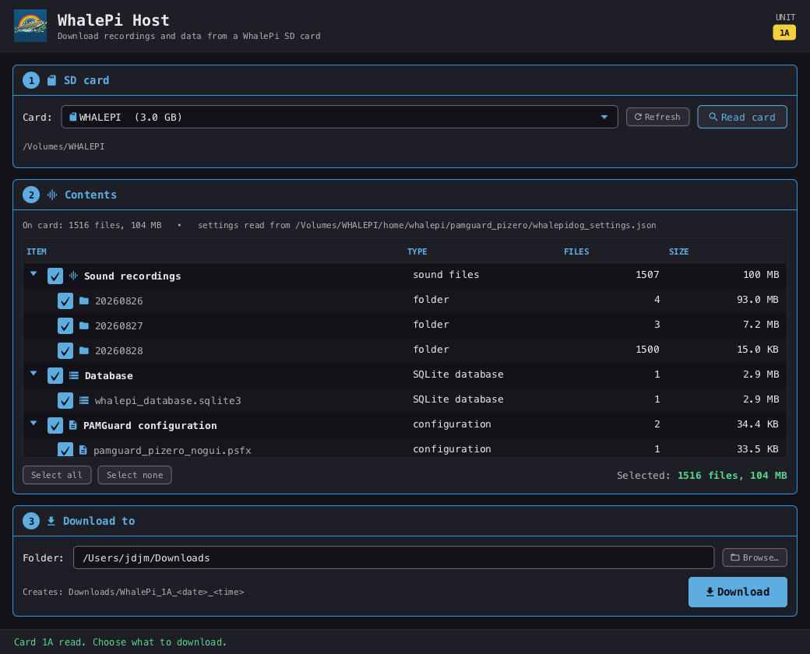

# WhalePi Host

A small desktop program for getting data off a [WhalePi](https://www.pamguard.org/) SD card.

When a WhalePi deployment finishes, the recordings, database and PAMGuard binary files are all
on the Pi's SD card — on a Linux ext4 partition that Windows and macOS cannot normally read.
WhalePi Host reads that partition itself, with no driver to install: put the card in a reader,
pick it from the list, and copy off what you want.



---

## What it does

1. **Pick the card** – choose it from the drive list and press Read. Partitions the computer can
   see but has not mounted are listed too, greyed out, with an explanation of what to do about
   them (see below).
2. **See what's on it** – WhalePi Host finds `whalepidog_settings.json`, reads the unit's serial
   number and the configured paths from it, then reports the file count and total size of:
   - the **sound recordings** folder, broken down by day folder (`yyyymmdd`)
   - the **SQLite database**
   - the **`.psfx` PAMGuard configuration** (plus the settings file itself)
   - the **PAMBinary folder**, broken down by sub-folder, if the deployment produced one
3. **Download it** – tick the items you want (everything is ticked by default), choose a folder,
   and press Download. The files are copied into a new folder named for the unit and the time,
   for example `WhalePi_1A_20260830_142530/`.

The unit's serial number (the `identification` field in the Bluetooth settings) is shown in the
top right of the window and used to name the download folder.

## Reading the card: no driver needed

A WhalePi SD card has two partitions:

| Partition | Filesystem | Holds |
|---|---|---|
| `bootfs` (~500 MB) | FAT32 | the Raspberry Pi's start-up files |
| the rest of the card | **ext4** | `PAMRecordings`, the database, the binaries — everything you want |

Windows and macOS understand FAT32 but not ext4, so they mount only the small `bootfs`
partition and ignore the large one. A 1 TB card turns up as a 500 MB drive with nothing useful
on it, and the usual advice — install an ext4 driver — is no help on a managed machine where
you are not allowed to.

**WhalePi Host reads ext4 itself.** It parses the filesystem in user space, straight off the
partition: superblock, block group descriptors, inodes, extent trees and directory entries. It
mounts nothing, installs nothing, loads no kernel extension and writes nothing to the card. The
unmounted data partition simply appears in the card list, ready to read.

### Permission to read the disk

Reading a partition directly means opening its device node, and the operating system guards
those:

| Platform | What is needed |
|---|---|
| macOS | Raw disks are `root:operator`. Join that group once: `sudo dseditgroup -o edit -a $USER -t user operator`, then log out and back in. WhalePi Host shows this command, with your user name filled in, when it is needed. |
| Windows | Run WhalePi Host as Administrator. |
| Linux | Usually already fine; otherwise join the `disk` group. |

That is a permission change, not a system change: nothing is installed and no kernel extension
is loaded. If you would rather not, the alternatives are to copy the data off with any Linux
computer, or to leave the Pi powered, attach a USB drive and send the `copywavdata` command
from the phone app.

### What the reader supports

Extent-mapped and older indirect-mapped files, 64-bit filesystems, `flex_bg`, sparse files,
files of any size, and directories of any size. Metadata checksums are not verified, which is
harmless when only reading.

The journal is **not** replayed. A card pulled out of a running Pi may have its newest few
writes sitting in the journal; WhalePi Host notices that the filesystem was not cleanly
unmounted and says so, and everything already written reads correctly. Shut the Pi down
properly before removing the card and the question does not arise.

## Where the paths come from

Every path is read from `whalepidog_settings.json` rather than assumed:

| Settings key | Used for |
|---|---|
| `recordingFolder` (or the legacy `wavFolder`) | the recordings folder |
| `database` | the `.sqlite3` database |
| `psfxFile` | the PAMGuard configuration |
| `pambinaryfolder` | the PAMBinary folder (optional) |
| `bluetoothSettings.identification` | the unit's serial number |

Those paths are recorded as they appear *on the Pi* (`/home/whalepi/PAMRecordings` and so on).
WhalePi Host works out where the settings file sits on the card, uses that to establish which
folder stands in for the Pi's root, and re-anchors every path onto the card. If a path still
does not resolve, it falls back to searching the card for a folder or file of that name — so it
copes with cards that have been partially copied or rearranged.

If `pambinaryfolder` is missing from the settings file, WhalePi Host looks for a folder called
`PAMBinary`; if there isn't one, the Binary files row simply reads *none on this card*.

---

## Building

Requirements: **JDK 17 or later** and **Maven 3.6+**.

Run it during development:

```bash
mvn clean javafx:run
```

### Running from an IDE

Run **`whalepihost.Launcher`** — it is the only class with a `main` method, for a reason.
JavaFX is on the class path rather than the module path, and the JVM refuses to start a main
class that extends `Application` under those conditions:

```
Error: JavaFX runtime components are missing, and are required to run this application
```

`Launcher` does not extend `Application`, so it starts normally and hands off to
`WhalePiHostApp`. This is the standard workaround for the long-standing Eclipse behaviour;
`WhalePiHostApp` deliberately has no `main` of its own so there is nothing else to launch by
mistake.

Build a runnable jar and the staged application folder:

```bash
mvn clean package
```

### Installers

`jpackage` can only build an installer for the platform it runs on, so build each one on that
platform. The profiles activate automatically by OS.

macOS — produces `target/installer/WhalePi Host-1.0.0.dmg`:

```bash
mvn clean verify
```

Windows — produces `target\installer\WhalePi Host-1.0.0.msi`:

```bash
mvn clean verify
```

Both installers bundle their own Java runtime, so users do not need Java installed.

The macOS build is unsigned. On a Mac that has not seen it before, the first launch needs
right-click → Open, or `xattr -dr com.apple.quarantine "/Applications/WhalePi Host.app"`.

## Project layout

```
src/main/java/whalepihost/
  Launcher.java              the only main method - run this one
  WhalePiHostApp.java        JavaFX Application, started by Launcher
  model/
    SettingsReader.java      parses whalepidog_settings.json
    WhalePiSettings.java     the values read from it
    CardScanner.java         finds the deployment and reads what is on it
    CardSource.java          an opened card: a mount, or a raw ext4 partition
    CardFile.java            a file or folder, whichever kind of card it is on
    LocalCardSource.java     a card the OS has mounted
    Ext4CardSource.java      a card read directly off its ext4 partition
    CardContents.java        a scanned card
    DataNode.java            one row of the contents tree
    FolderStats.java         recursive file count and size
    Volume.java              the card list, including unmounted ext4 partitions
  ext4/
    Ext4FileSystem.java      the read-only ext2/3/4 reader
    BlockDevice.java         aligned, cached reads over a device or image
    Ext4Inode.java           one inode
    Ext4DirEntry.java        one directory entry
    Extent.java              a run of blocks
    Ext4InputStream.java     streams a file's contents
  copy/
    ScanJob.java             background scan
    CopyJob.java             background copy, with byte-level progress
  ui/
    MainView.java            the window
    Icons.java, Palette.java the phone app's icons and colours
src/main/resources/whalepihost/
  whalepihost.css            dark theme matching the phone app
  whalepi_icon.png           app icon
src/main/deploy/
  whalepi.icns, whalepi.ico  installer icons
```

## Related

- [whalepidog](https://github.com/WhalePi/whalepidog) – the watchdog that runs PAMGuard on the Pi
- WhalePi phone app – connects over Bluetooth for live status and the `copywavdata` command
